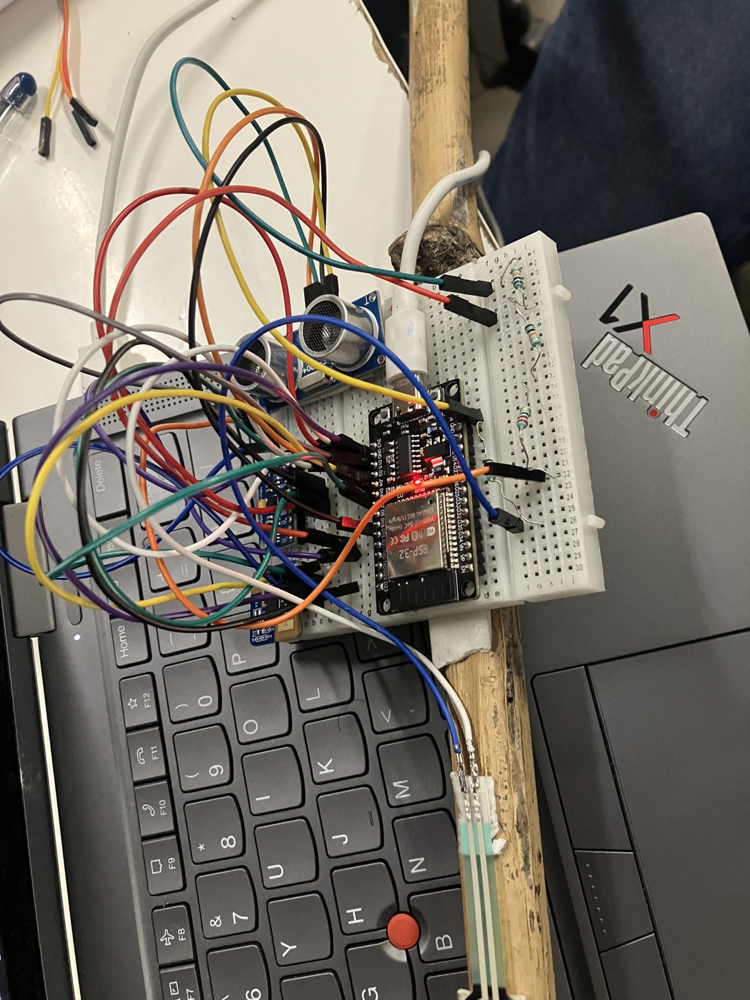
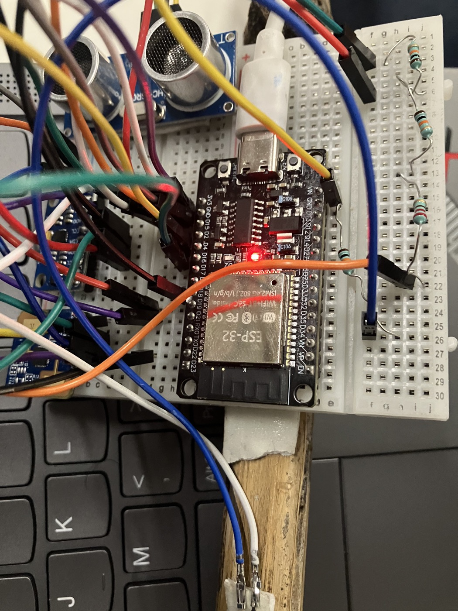
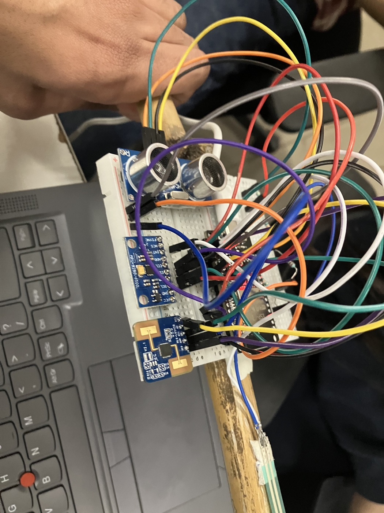
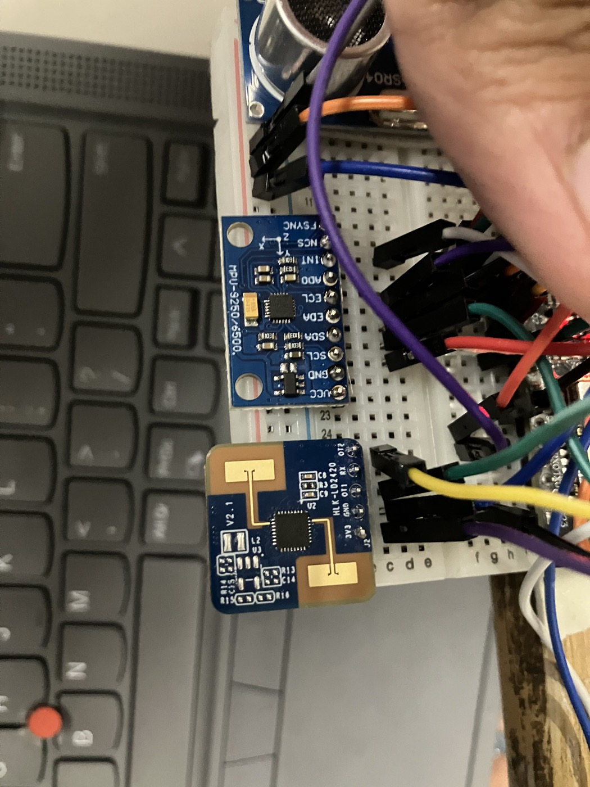
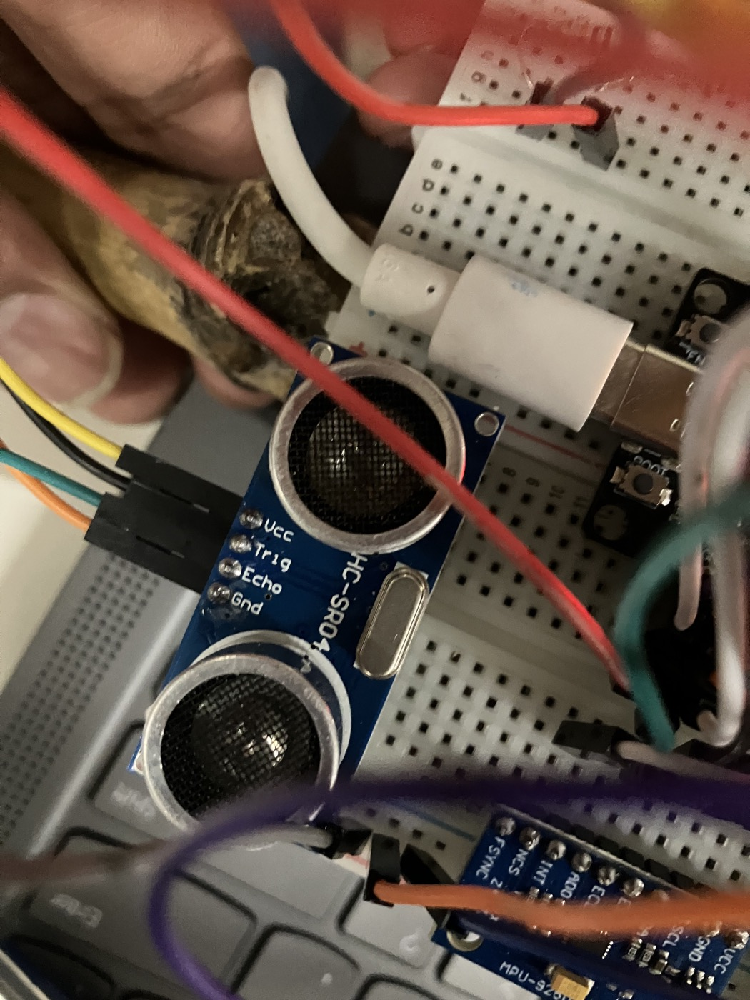

# StrideCare

StrideCare is an offline-first recovery companion for people using a smart cane between physiotherapy visits. It supports physiotherapy and has no medical-device function.

## Hardware prototype











## Run

Use Flutter **3.50.1 stable** with Dart **3.14.0**. The project root is the folder containing this file. Install Chrome for web, Android SDK Platform 37 and a compatible JDK for Android, or Xcode with its first-launch components, CocoaPods and an iOS simulator or provisioned device for iOS. Run `flutter doctor -v` to check the toolchain for your target.

```sh
flutter pub get
flutter gen-l10n
dart run build_runner build
flutter analyze
flutter test
flutter run -d chrome
```

For mobile, run `flutter devices` and then `flutter run -d <device-id>`. Run `flutter build web --no-web-resources-cdn` for a web bundle with local rendering resources. Serve the contents of `build/web` over HTTPS or localhost. Serve `.wasm` as `application/wasm`. Keep the origin and port stable to retain browser data between launches.

## Run the connected app

The Firebase build adds patient and clinician accounts, assignment-based access, automatic walk uploads and live target updates. The default build runs the offline practice experience. [Connected setup, demo accounts, dataset and schema](backend/README.md)

## Try the practice app

Open the patient app at the server root. Choose a language and complete the nine setup screens. Use two different international-format phone numbers. Practice contacts are saved locally. The simulator does not send consent messages, SMS or calls.

From Today, select **Cane not connected. Fix this**. Follow the attachment and simulated calibration screens, then select **See today**. Leave the app open. The mock grip, tip-load and step streams trigger Live Walk automatically. Release or sustained inactivity ends the walk. Progress shows saved sessions, daily charts and the weekly PDF. The first walk can take a few minutes to finish. A recovery score appears after two recorded days.

Open **/?view=clinic** on the same origin and browser profile to inspect practice trends, set thresholds, set daily ring goals and approve seated breathing. Reopen the patient view and reconnect the mock cane after changing thresholds. **/?view=family** displays activity, estimated pace and fall history. Both are local demonstration views. They share browser storage and provide no remote access or authentication.

Medicine stores individual scheduled entries and taken times. Scheduling a future entry on Android or iOS requests notification permission. The web build keeps the log only. Wellness includes meal ideas across four cuisines, a daily meal check-in and an approval gate. The fall simulator stores detections and acknowledgements, shows a 10-second countdown and advances through two simulated contact stages.

## Implementation status

Flutter web is the verified build target. The mobile projects include reminder integration but need device testing. Clinical deployment still requires hardware validation, background capture and buffering, production Firebase provisioning, contact consent and emergency delivery with location and acknowledgements. The current wellness library does not yet provide a stage-specific guided rehabilitation program. Hindi and Punjabi strings are flagged for native-speaker review.

Walk thresholds live in `lib/features/walk/detection_config.dart`. The demo recovery formula is in `lib/features/progress/recovery_score.dart`. Daily averages weight load and rhythm by counted steps and calculate estimated pace from total distance and walking time. Sessions are attributed to their local start day.

## Offline storage

Read `databaseProvider` to open the local Drift database on first use. Mobile uses a SQLite file. Web uses a bundled SQLite engine and Drift worker with browser-managed storage. Clearing browser site data removes its database. Keep `web/sqlite3.wasm` and `web/drift_worker.js` matched to the locked Drift release when upgrading. [Drift web setup](https://drift.simonbinder.eu/platforms/web/)

Schema version 2 includes the original 13 typed tables plus local preferences. Insert a user and both emergency contacts inside one `db.transaction`. Store international-format phone numbers and use positions 1 and 2. Deferred foreign keys enforce a complete pair at commit. Missing, extra and duplicate numbers fail the transaction. To exchange contacts, replace the pair inside one transaction. Read in position order. The schema documents units for load, cadence, distance and estimated pace.

## How to connect real hardware

1. Confirm the module’s GATT service, characteristic UUIDs, sensor units, sample timestamps, step-counter rollover and vibration command with the firmware team. The UUIDs in `lib/features/cane/data/ble_config.dart` are placeholders.
2. Implement discovery, subscriptions, decoding and vibration writes inside `BleCaneService` using `flutter_reactive_ble`. Add the platform Bluetooth permission descriptions and runtime requests when pairing is implemented. The current stub reports the missing firmware contract on connection.
3. Preserve the `CaneService` stream contract. Tip load is in newtons, cadence is in steps per minute, estimated speed is in metres per second and steps is a cumulative counter. End subscriptions on disconnect and clean up on disposal.
4. Change `final service = MockCaneService();` to `final service = BleCaneService();` in `lib/features/cane/application/cane_provider.dart`. Both implementations are exported there. UI code depends only on the abstract service. Keep the mock for web unless a browser transport is available.
5. Validate the readings and vibration on a physical Android or iOS device. Walk detection consumes grip, load and steps. The UI has no manual walk controls.

The mock emits a one-second telemetry sample after connection. It simulates picking up the cane, loading the tip, stepping, pausing while holding it, releasing it and resting between walks. Slower days, a gradual change in estimated pace and cane load, battery discharge and occasional fall events are modelled. Tests can inject a seed, sample interval, clock and recovery start date. Mock vibration acknowledges the command in software.

Today includes an SOS check-in. The default practice build sends no messages. See [SOS and scheduled report setup](backend/DELIVERY.md) for the connected build and its delivery limits.
